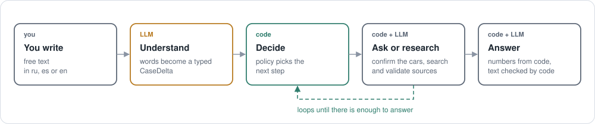
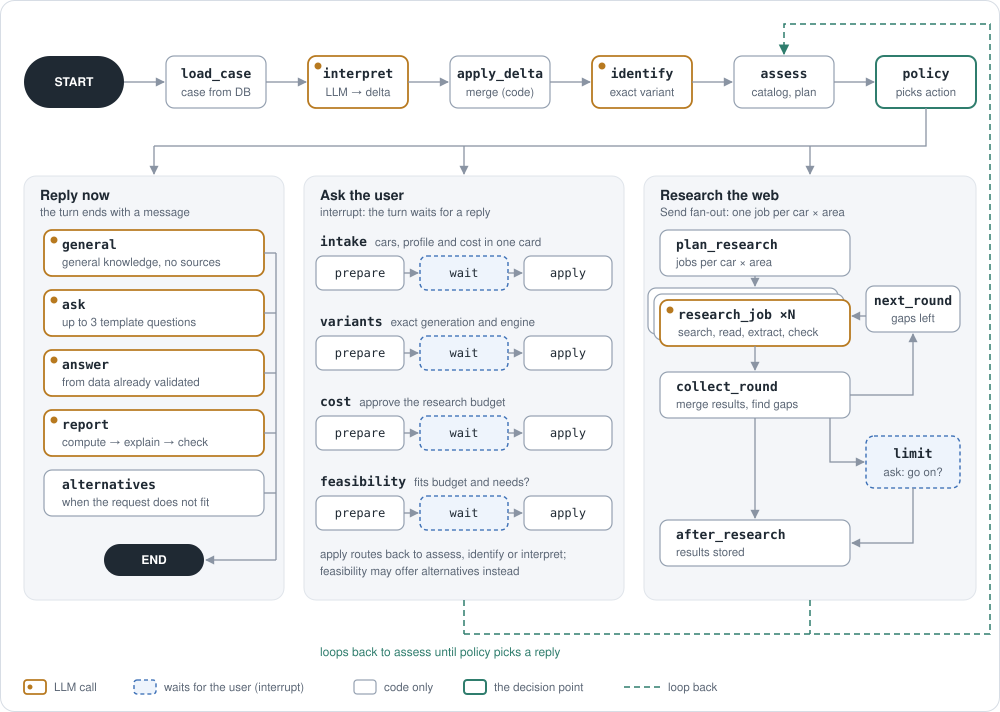
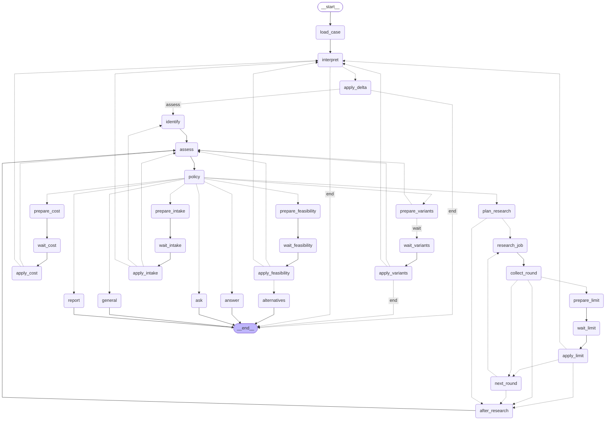

# AutoMind

**A conversational car expert that shows its evidence.** Describe what you need in your own words — in Russian,
Spanish or English — and AutoMind works out which cars you mean, asks only what would change the answer,
researches what is missing on the web with checked sources, and answers for *you*: a family buyer, a
performance enthusiast or an engineer.

The rule that shapes the whole design: **numbers come from code, the AI only explains them.** Scores, ownership
cost, the drag-race simulation and the verdict are computed deterministically; the language model reads your
message and writes the explanation, and code checks that explanation against the numbers.

> Status: advanced MVP for a single user on a local machine. See [Status and limits](#status-and-limits)
> before exposing it to anyone else.

---

## Contents

- [What it does](#what-it-does)
- [How a turn works](#how-a-turn-works)
- [Why LangGraph, and what it does here](#why-langgraph-and-what-it-does-here)
- [The turn graph](#the-turn-graph)
- [Research: from search result to trusted value](#research-from-search-result-to-trusted-value)
- [Reports](#reports)
- [Architecture](#architecture)
- [Tech stack](#tech-stack)
- [Run it](#run-it)
- [Tests and quality gates](#tests-and-quality-gates)
- [Status and limits](#status-and-limits)
- [Further reading](#further-reading)

---

## What it does

You write something like:

> *«Мне 20, могу купить б/у BMW 320d M Sport или Golf R-Line 4Motion — сравни на драг-рейсинг, город и горы»*

AutoMind then:

1. **Understands the request.** It keeps a *case file* — the cars, your budget, how you drive, what matters to
   you — and updates it with every message. Corrections work ("1.5, not 1.0").
2. **Pins down the exact cars.** Generation, engine and body are confirmed with you on one card, so a 150 hp and
   a 250 hp version never get mixed up. Unknown models are never invented.
3. **Researches what is missing.** Favourite sites first (km77, ultimatespecs, auto-data, ADAC, Parkers…), then
   the open web. Every value keeps the exact quote it came from.
4. **Answers for your profile.** A verdict first — a pick or an honest tie — then the comparison, ownership
   cost, reliability, a simulated drag race and the sources, in an order that fits a buyer, an enthusiast or an
   engineer.

Things to try in the chat:

1. "I don't want to spend too much, but I don't want rubbish either. A brand-new Dacia Bigster or a used Land Cruiser Prado?"
2. "about 10 years old, the 150" → confirm the J150 → a buyer's report with ownership cost
3. "if I prefer status, who wins?" — recomputed from stored data, no new research
4. "the same, but I'm a car engineer" — the report is reordered for an expert

---

## How a turn works



Every message starts a **turn**. The LLM turns your words into a typed change to the case file (`CaseDelta`).
Code merges it and a deterministic **policy** decides the next step: answer, ask, confirm, research or report.
Asking and researching loop back until there is enough to answer.

---

## Why LangGraph, and what it does here

LangGraph is the **state machine of a turn**. It does not make decisions — `domain/policy.py` does, as plain
code. LangGraph gives that state machine four things that would otherwise be hand-written and fragile:

| LangGraph feature | What AutoMind uses it for |
| --- | --- |
| **Durable state** (Postgres checkpointer) | One thread per chat. A turn survives a server restart and continues from its last step (`ChatRunner.resume_incomplete`). |
| **Interrupts** (`interrupt()` / `Command(resume=…)`) | Human-in-the-loop confirmations: the exact cars, the research cost, "does it fit your budget?", "continue past the limit?". The turn pauses, the UI shows a card, the answer resumes it. |
| **`Send` fan-out with a reducer** | Parallel research: one job per car × area, results merged by the `results` reducer, more rounds while gaps remain. |
| **Explicit graph** | Every possible path of a turn is visible in one file (`orchestration/graph.py`) and can be drawn from code. |

What LangGraph deliberately does **not** do here:

- **It does not route with an LLM.** No supervisor agent, no "decide what to do next" prompt. Routing is
  `policy.decide(case, assessments)` — pure, typed and unit-tested.
- **It is not the store of truth for the case.** The case file is versioned in Postgres; graph state holds only
  workflow data for the current turn and is reset by `load_case`.
- **LLM calls are leaf tasks** inside nodes (interpret, identify, research extraction, the reporter), each with a
  typed output and a check in code after it.

---

## The turn graph



How to read it:

- **Top row — understanding.** `load_case` reads the case file, `interpret` (LLM) turns the message into a
  `CaseDelta`, `apply_delta` merges it in code, `identify` resolves the exact variants, `assess` checks the
  catalog and builds a research plan with a cost estimate.
- **`policy` is the only decision point.** It picks one action and the graph follows one of three lanes.
- **Reply now.** `general`, `ask`, `answer` and `report` end the turn with a message. `report` computes the
  blocks first, then the LLM explains them, then `guard` and `report_check` remove sentences whose numbers or
  claims are not in the validated data.
- **Ask the user.** Each confirmation is the same three steps: `prepare_*` builds the card, `wait_*` only calls
  `interrupt()` (so nothing runs twice on resume), `apply_*` merges the answer. A free-text answer is sent back to
  `interpret`, because it may be a correction.
- **Research the web.** `plan_research` fans out `research_job` per car and area with `Send`; `collect_round`
  merges results and either starts `next_round` for the gaps, pauses at a limit to ask whether to continue, or
  finishes in `after_research`.
- **The dashed line** is the loop: after a confirmation or a research round the turn goes back to `assess`, and
  `policy` decides again.

The picture above groups nodes for readability. The complete graph, generated from the code:

<details>
<summary>Full graph as generated by <code>get_graph().draw_mermaid()</code> (31 nodes)</summary>



</details>

Regenerate it after changing `graph.py`:

```bash
cd backend
uv run python -c "from automind.orchestration.graph import build_graph; \
print(build_graph(tools=[]).get_graph().draw_mermaid())" > ../docs/graph.mmd
```

For step-by-step tracing of real turns, set `LANGSMITH_TRACING=true` and `LANGSMITH_API_KEY` (texts are then
sent to LangSmith). The checkpoint history of a chat is also available locally through
`graph.aget_state_history({"configurable": {"thread_id": chat_id}})`.

---

## Research: from search result to trusted value

Each `research_job` turns web pages into values the report may use. A value is stored only if it passes every
step:

1. **Search** — favourite sites per area and market first (`site:a OR site:b`), open web only for what is still
   missing; Serper by default, SerpApi or Tavily as fallback; results cached.
2. **Fetch** — deny-list (classified-ads sites are never contacted), `robots.txt` and crawl delay, per-host rate
   limit, size and type limits; pages cached in Postgres with a freshness window per area.
3. **Relevance gate** — a page about another generation, engine or body is rejected before extraction, and the
   reason is shown in the sources block.
4. **Extraction** — deterministic table readers for km77, ultimatespecs and auto-data; an LLM extractor with a
   strict schema elsewhere. Every claim must carry the exact excerpt it came from.
5. **Validation in code** — the excerpt must occur in the page, units are normalised (CV → kW, mph → km/h,
   `1.234,5` / `1,234.5`), plausibility ranges, sense rules (WLTP vs NEDC vs real-world consumption, e-CVT gear
   counts, market of a price), and agreement across sources.
6. **Confidence** — values are clustered by tolerance; the chosen value gets a confidence with its reason
   (`HIGH:2_INDEPENDENT_AGREE`, a single source, a conflict…). An unclear case goes to an LLM validator.

---

## Reports

- **Verdict first** — the pick or a tie, the reasons in numbers, the main trade-off, and what would change the
  answer. Built by code (`domain/insights.py`, `domain/verdict.py`); a difference smaller than the tie margin is
  reported as a tie.
- **Criteria scores** — 0–100 indices per criterion with their inputs; weights come from the profile and your
  stated priorities, and you can edit them. Ranking uses only criteria that every compared car has data for.
- **Ownership cost** — fuel or energy, insurance, tax, maintenance, depreciation; every line labelled *sourced* or
  *assumption*.
- **Drag race** — a deterministic simulation (0–100, 0–200, 400 m) from power, torque, mass and drivetrain,
  labelled as a simulation.
- **Reliability, reviews, manufacturer, engineering** — with the sources they come from.
- **Layout per profile** (`config/report_layouts.yaml`): a buyer sees cost and value first, an enthusiast the
  performance, an engineer the technology.
- **Dialogue** — *wrong?* on any value re-checks it, *Find it* researches a missing one, critique leads to new
  research or a reworked report, and every report can be rated 1–5.

---

## Architecture

```text
backend/src/automind
├── domain/          pure rules: case file, policy, identity, criteria, TCO, drag race, evidence, units, verdict
├── application/     use cases: interpret, identify, resolve, research, extraction, compose (report blocks)
├── orchestration/   LangGraph: graph.py, nodes/, runner.py (turn lifecycle), guard.py, prompts/*.md
├── infrastructure/  LLM gateway, search providers, fetch + page store, site readers, Postgres, checkpointer
├── api/             FastAPI: ws.py (protocol v2 with replay), rest.py (/api/v1), app.py (composition)
└── mcp_server.py    read-only analysis tools over validated data
frontend/src         React chat, case panel, report blocks (ECharts), i18n ru / es / en
backend/config       models per role, sources, queries, criteria, rates, rules — data, not code
```

Principles the code holds to:

- **The domain is pure.** `domain/` imports no framework, HTTP or database code; `import-linter` enforces it.
- **The LLM proposes, code decides.** Every LLM output is a typed schema that code validates before it changes
  anything.
- **Evidence before conclusions.** No value without a source and a quote; no comparison on missing data.
- **Ask only what changes the answer.** Questions come from localized templates and are never repeated.
- **Configuration is data.** Models per role, prices, sources, query templates, criteria, rates and thresholds
  live in `backend/config/*.yaml`.
- **Every turn is accounted for.** AI calls, tokens, searches and euros are counted per turn and per role, with
  limits on calls, time and cost.

Where to start reading: `domain/policy.py` (what happens next), `domain/casefile.py` (the memory),
`orchestration/graph.py` (the turn), `application/research.py` (the research pipeline),
`application/compose.py` (the report blocks).

---

## Tech stack

| Area | Choice |
| --- | --- |
| Backend | Python 3.13, FastAPI, WebSocket protocol v2, Pydantic |
| Orchestration | LangGraph ≥ 1.0 with `langgraph-checkpoint-postgres` |
| Models | Gemini by default (`langchain-google-genai`); one model per role in `config/models.yaml`, override with `MODEL_<ROLE>` |
| Data | PostgreSQL 16, SQLAlchemy 2 (async), Alembic |
| Web research | Serper / SerpApi / Tavily, httpx, trafilatura, selectolax, pypdf |
| Tools | MCP server with scoped read-only tools |
| Frontend | React 18, TypeScript, Vite, Tailwind, Zustand, ECharts |
| Quality | ruff, mypy (domain), import-linter, pytest, vitest |

---

## Run it

### Local development

```bash
# 1. Keys in .env (copy .env.example):
#    GOOGLE_API_KEY (Gemini, the default models) and SERPER_API_KEY; TAVILY_API_KEY optional fallback
# 2. Build the frontend once
cd frontend && npm install && npm run build && cd ..
# 3. Postgres 16 in Docker (127.0.0.1:5433), migrations, API on the host (also serves the frontend)
scripts/dev.sh
# 4. Open http://127.0.0.1:8000
```

- UI work: `cd frontend && npm run dev` → http://127.0.0.1:5173 (proxied to the API).
- No uv or node on the host: `scripts/dev.sh --docker` runs the API from the image with `backend/` mounted
  (`uvicorn --reload`) and Vite in a `node:22` container on 5173 (host network, Linux).
- No backend at all: open the UI with `?mock=1` to see recorded data.
- Other model providers: set `MODEL_<ROLE>=provider:model` (for example `MODEL_REPORTER=openai:gpt-5.4`) and the
  matching API key.

### Docker

```bash
scripts/deploy.sh              # build, start app + Postgres 16, migrate, wait until healthy → http://127.0.0.1:8080
scripts/deploy.sh status       # containers + health
scripts/deploy.sh logs         # follow app logs
scripts/deploy.sh backup       # pg_dump → backups/automind-<time>.sql.gz  (restore: scripts/deploy.sh restore <file>)
scripts/deploy.sh down         # stop, data kept
```

Keys come from `.env` at run time and are never baked into the image. `deploy.sh` checks only the keys the
configured providers need (Gemini: `GOOGLE_API_KEY` or `GEMINI_API_KEY`; the search provider's key;
`OPENAI_API_KEY`/`ANTHROPIC_API_KEY` only if `models.yaml` or a `MODEL_<ROLE>` override uses them) and names any
that are missing. `POSTGRES_PASSWORD`, `ADMIN_TOKEN` and `METRICS_TOKEN` are generated into `.env.docker` when
absent; existing values are kept. The container runs migrations before
uvicorn, runs as a non-root user and exposes `/api/v1/health`. It binds to 127.0.0.1 by default
(`AUTOMIND_BIND`, `AUTOMIND_PORT`); put a reverse proxy with TLS in front before exposing it.

```bash
scripts/deploy.sh up --monitoring        # also Prometheus (127.0.0.1:9090, 400 days) + Alertmanager (127.0.0.1:9093)
scripts/deploy.sh monitoring up|down|status
scripts/deploy.sh export [--encrypt]     # one bundle: DB dump, .env, .env.docker, metrics token, deploy/ config
scripts/deploy.sh import <bundle>        # on a fresh clone: same commit, secrets, dump, healthy
scripts/deploy.sh move user@host [dir]   # export → clone on the target → import there (this stack keeps running)
scripts/deploy.sh bootstrap              # empty server: checks Docker/compose/git, prints install commands, creates .env
```

Moving to another server step by step, and how to verify it: [docs/deploy.md](docs/deploy.md). Alert rules live in
`deploy/prometheus/automind-rules.yml`; put your Telegram/Slack/e-mail receiver in
`deploy/prometheus/alertmanager.yml` (it ships a placeholder that delivers nowhere).

**Public HTTPS (optional).** The compose profile `public` adds Caddy (`caddy:2.10`, `deploy/caddy/Caddyfile`) with
automatic Let's Encrypt certificates on ports 80/443, reverse-proxying to the app (`/metrics` is not proxied). Set
`AUTOMIND_DOMAIN=automind.example.com` in `.env.docker`, point DNS at the server, keep `AUTOMIND_BIND=127.0.0.1`, and
run `scripts/deploy.sh up --public`. AutoMind has no login yet: before a public exposure, work through the security
list in [docs/review-2026-11-03.md](docs/review-2026-11-03.md) (and the limits below).

---

## Tests and quality gates

```bash
scripts/check.sh                                  # ruff, format, mypy (domain), import-linter, pytest, frontend
scripts/check.sh --docker                         # the same inside the Dockerfile `check` stage (host needs only Docker)
cd backend
uv run pytest tests/unit                          # pure rules
uv run pytest tests/graph                         # graph mechanics: fake LLM + fixture search + real Postgres
uv run pytest tests/golden                        # golden dialogues G1–G7, replayed from cassettes (free)
uv run pytest tests/golden -m live                # golden dialogues against real models (costs money)
uv run pytest tests/eval -m live -s               # used-car generation resolution, 22 cases
```

Golden dialogues and their last live results: [backend/tests/golden/README.md](backend/tests/golden/README.md).

---

## Status and limits

AutoMind is built for one person on one machine. Before showing it to others:

- **No login.** Anyone who can reach the server can read all chats and spend the API budget. Keep
  `API_HOST=127.0.0.1` (the default).
- **One process.** Running turns and live events are held in memory; run a single worker.
- **Pasted links are fetched by the server.** Do not expose it to untrusted users until private addresses are
  blocked.
- **Models changed recently.** The default switched from OpenAI to Gemini; the golden set was last run live on
  the previous models.
- **Spain-first data.** Prices, line-ups and favourite sources target the Spanish market.

---

## Further reading

- Vision: [docs/vision.md](docs/vision.md) · Rules: [.specify/memory/constitution.md](.specify/memory/constitution.md)
- Feature specs: [specs/](specs/) — 001 car battle MVP, 002 conversational MVP, 003 research quality and search, 004 report experience, 005 intake and identification
- Architecture decisions: [docs/adr](docs/adr/README.md)
